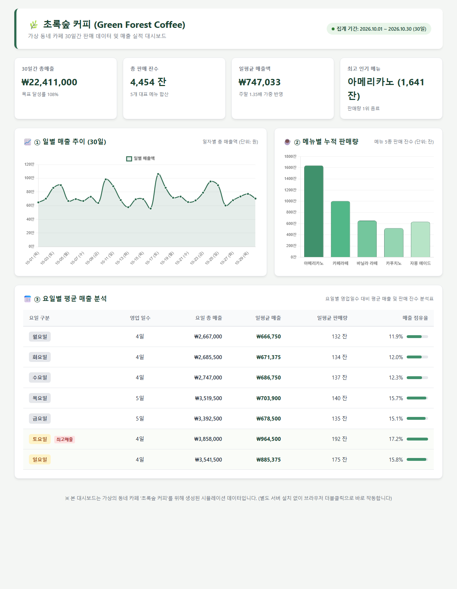

# 🌿 동네 카페 매출 대시보드 (Neighborhood Cafe Sales Dashboard)

가상의 동네 카페 **「초록숲 커피 (Green Forest Coffee)」**의 30일간 판매 데이터 및 매출 실적 분석 대시보드입니다.

## 🚀 실행 방법
별도의 서버 구동이나 패키지 설치 없이, `index.html` 파일을 브라우저로 열면(더블 클릭) 바로 작동합니다.

## 📁 파일 구조
- `index.html`: 대시보드 메인 페이지 (Chart.js CDN 사용)
- `data.js`: 30일간 5종 메뉴 판매량 및 매출 가상 데이터
- `chart.js`: 차트(꺾은선, 막대) 및 요일별 평균 매출 분석 테이블 렌더링 스크립트
- `dashboard_screenshot.png`: 대시보드 브라우저 실행 스크린샷

## 📊 주요 기능 및 분석 지표
1. **일별 매출 꺾은선 차트**: 30일간 일자별 총매출 추이 시각화
2. **메뉴별 누적 판매량 막대 차트**: 대표 메뉴 5종의 누적 판매 잔수 및 매출 비교
3. **요일별 평균 매출 분석표**: 요일별 영업일수 대비 일평균 매출, 판매량 및 매출 점유율
4. **핵심 실적 지표 (KPI)**:
   - 30일 총매출: **₩22,411,000**
   - 총 판매 잔수: **4,454 잔**
   - 일평균 매출: **₩747,033**
   - 최고 인기 메뉴: **아메리카노** (1,641 잔)

## 📸 미리보기

